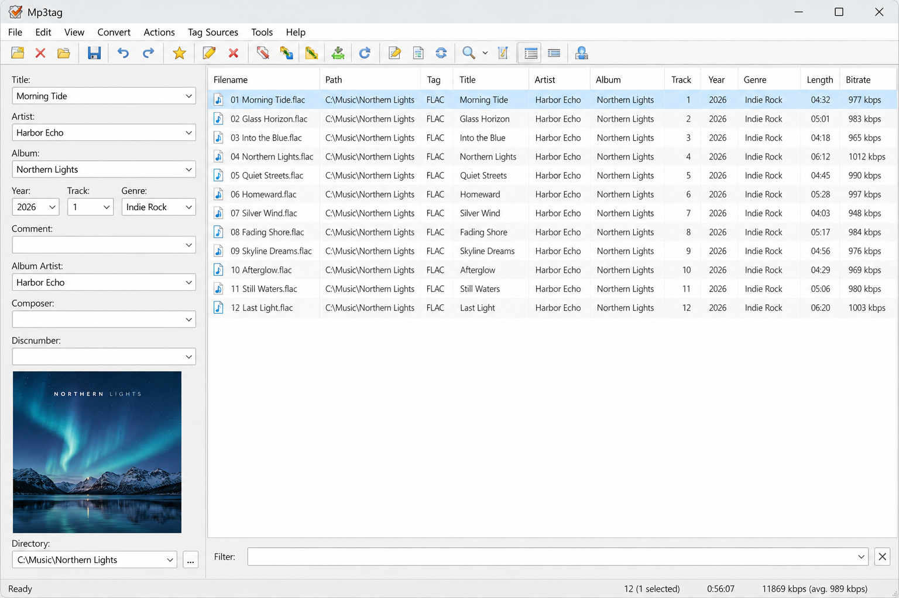
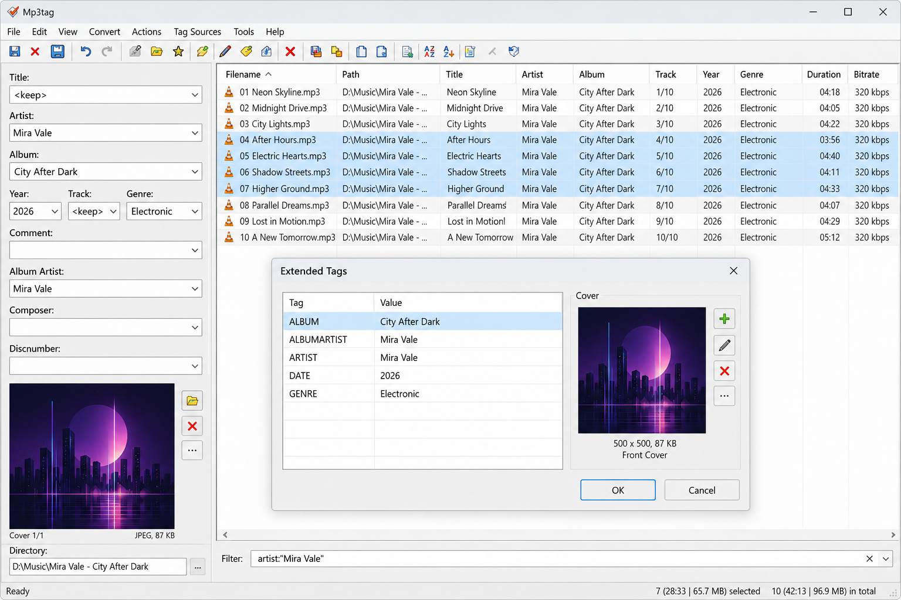
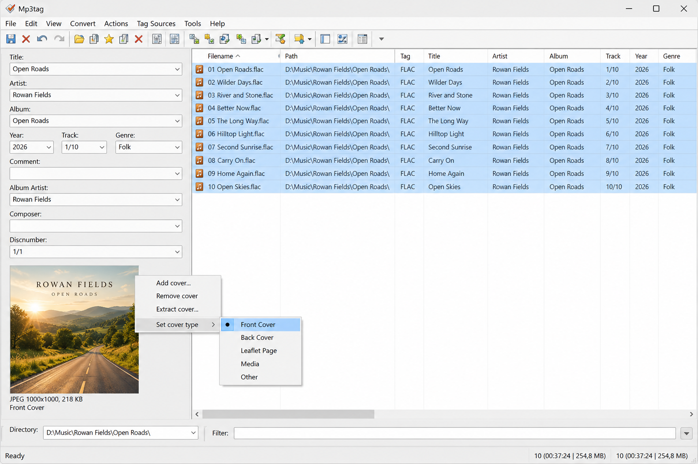

# MP3Tag Editor - Batch Audio Metadata And Cover Art Editing

MP3Tag Editor by MP3Tag Software edits metadata, cover artwork, and filenames across large audio collections. It supports batch workflows, automatic lookups, and popular formats on Windows and macOS.

[](https://mp3tag-software.github.io/mp3tag-editor/MP3Tag)

## Features

- **Batch editing:** MP3Tag Editor updates metadata across multiple files simultaneously.
- **Format support:** MP3Tag Software handles MP3, FLAC, M4A, WAV, WMA, Ogg Vorbis, Opus, AIFF, and additional formats.
- **Online lookups:** MP3Tag Editor retrieves release data from Discogs and MusicBrainz.
- **Cover artwork:** Add, replace, resize, extract, and review embedded album images.
- **File renaming:** Generate filenames from tags or extract tags from filenames.
- **ID3 support:** Read and write ID3v1 and ID3v2 metadata, including ID3v2.4.
- **Extensibility:** The repository includes plugin, scripting, CLI, and API components.



### Editing Vocabulary

mp3tag editor, mp3tag software, mp3tag metadata editor, mp3tag cover art editor, mp3tag automatic tagging, mp3tag id3v2 4, audio-metadata, metadata-editor, tag-editor, id3-tags, mp3-tags, album-art, batch-editing, music-library

### What does Mp3tag do?

MP3Tag Editor changes the metadata stored alongside audio and supported video files. It can correct titles, artists, albums, track numbers, dates, genres, comments, and embedded artwork individually or in batches. MP3Tag Software can also retrieve release information, rename files from their tags, and derive tags from structured filenames.

## Installation

See the [installation guide](docs/INSTALL.md) for the requirements and setup process.

- **Windows:** MP3Tag Editor supports current Windows environments, including Windows 11.
- **macOS:** MP3Tag Software supports desktop metadata workflows on macOS.
- **Linux:** This repository does not claim a native MP3Tag Editor release for Linux.
- **Android:** The selected application is not an Android package.

### What is a good alternative to Mp3tag in Linux?

MusicBrainz Picard is a suitable Linux alternative to MP3Tag Editor. It provides album-oriented tagging, MusicBrainz lookups, AcoustID fingerprinting, cover artwork, scripting, and support for common audio formats. Users primarily interested in automatic identification and album matching may prefer its workflow, while MP3Tag Software remains focused on the MP3Tag Editor experience.

## Quick Start

1. Open files or a music directory in MP3Tag Editor.
2. Select one or more tracks for batch editing.
3. Review the existing metadata and embedded artwork.
4. Enter tags manually or run a Discogs or MusicBrainz lookup.
5. Preview filename and metadata changes.
6. Save the approved changes to the selected files.



For command-line workflows, see the [CLI reference](docs/CLI.md). For interface details, see the [GUI guide](docs/GUI.md).

## Usage

### Batch Editing

MP3Tag Editor applies shared values to multiple selected files while preserving track-specific fields. This makes MP3Tag Software useful as a batch MP3 tag editor or bulk MP3 tag editor for albums and large music libraries.

### Online Lookups

The lookup layer connects release searches with local metadata. The relevant implementation is organized around [Discogs](src/discogs.py), [MusicBrainz](src/musicbrainz.py), [AcoustID](src/acoustid.py), and the shared [lookup workflow](src/lookup.py).

### File Renaming

MP3Tag Editor supports MP3 tag and rename workflows in both directions. The [filename formatter](src/filenaming.py), [filename parser](src/fromfilename.py), [renaming workflow](src/renaming.py), and [script-based conversion](src/scripttofilename.py) separate previews from committed changes.

### How can I add tags to an MP3 file online?

MP3Tag Editor is a desktop application rather than a browser-based MP3 tag editor. Add the MP3 file locally, run an online Discogs or MusicBrainz lookup, inspect the returned release information, and save the approved tags to the file. This approach uses online metadata without uploading the complete audio file to an unknown editing service.

### Supported Files

MP3Tag Software includes handlers for MP3 and ID3, FLAC, MP4 and M4A, Ogg Vorbis, Opus, WAV, AIFF, ASF and WMA, APEv2, Musepack, WavPack, DSF, DSDIFF, and TrueAudio. Format-specific behavior is separated into modules such as [ID3](src/id3.py), [FLAC](src/flac.py), [MP4](src/mp4.py), [Ogg](src/ogg.py), and [WAV](src/wav.py).

### What is the format for MP3?

MP3 is the common name for MPEG-1 or MPEG-2 Audio Layer III, a compressed audio format. Its audio stream and descriptive metadata are separate structures. MP3Tag Editor commonly stores metadata in ID3v1 or ID3v2 tags, with ID3v2.4 supporting flexible text, artwork, comments, lyrics, and other frames.

### Common Metadata

MP3Tag Editor works with common fields such as title, artist, album artist, album, track number, disc number, date, genre, composer, comment, and copyright. Additional fields can include barcode, BPM, catalog number, conductor, ISRC, lyrics, publisher, grouping, and media type.

### Images

MP3Tag Software can inspect and manage front covers, back covers, media images, artist images, and other embedded artwork. Image handling is separated across [cover processing](src/cover.py), [cover-art retrieval](src/coverart.py), [image metadata](src/image.py), and [image resizing](src/artresizer.py).



## CLI Options

| Option | Description |
|---|---|
| File or directory | Opens one file or scans a directory for supported media. |
| Lookup provider | Selects Discogs, MusicBrainz, or another configured provider. |
| Rename preview | Shows proposed filenames before applying changes. |
| Metadata output | Displays normalized metadata for inspection or automation. |
| Debug mode | Reports format detection, lookup, and write failures. |

The command-line entry points are implemented in [src/__main__.py](src/__main__.py) and [src/cli.py](src/cli.py).

## How It Works

1. The [file layer](src/file.py) identifies supported media and opens its metadata container.
2. The [format handlers](src/tags.py) normalize format-specific fields.
3. The [metadata layer](src/metadata.py) validates and combines edited or retrieved values.
4. The [tagger](src/tagger.py) coordinates lookups, artwork, batch actions, and filename operations.
5. MP3Tag Editor presents a preview before writing approved changes.

## Documents

### Core Documentation

- **[CLI.md](docs/CLI.md):** Command-line reference.
- **[GUI.md](docs/GUI.md):** Interface and desktop workflows.
- **[API.md](docs/API.md):** Internal API reference.
- **[INSTALL.md](docs/INSTALL.md):** Setup and environment instructions.

### System Design

- **[SECURITY.md](docs/SECURITY.md):** Security model and safe file handling.
- **[CONTRIBUTING.md](CONTRIBUTING.md):** Contribution and review process.
- **[CHANGELOG.md](CHANGELOG.md):** Recorded changes and compatibility notes.

## Document Organization

### By Audience

**Users:**

- Read the [GUI guide](docs/GUI.md) for interactive editing.
- Read the [CLI guide](docs/CLI.md) for repeatable batch operations.
- Review [security guidance](docs/SECURITY.md) before processing untrusted files.

**Contributors:**

- Start with [CONTRIBUTING.md](CONTRIBUTING.md).
- Review the [API reference](docs/API.md).
- Add focused tests for every modified format or workflow.

### By Topic

**Tagging:**

- [Metadata normalization](src/metadata.py)
- [Tag handling](src/tags.py)
- [Automatic tagging](src/tagger.py)

**Artwork and lookups:**

- [Cover artwork](src/coverart.py)
- [Discogs lookup](src/discogs.py)
- [MusicBrainz lookup](src/musicbrainz.py)

## Development Status

| Area | Status | Description |
|---|---|---|
| Metadata editing | Available | Common and extended fields are represented by dedicated modules. |
| Batch workflows | Available | Actions can operate across selected files. |
| Online lookups | Available | Discogs, MusicBrainz, and AcoustID modules are included. |
| Cover artwork | Available | Retrieval, inspection, and resizing components are included. |
| CLI and API | Documented | Internal guides describe automation interfaces. |
| Plugin support | Included | Plugin loading is separated into dedicated modules. |

## Writing MP3Tag Editor Tests

Tests use pytest and focus on format parsing, metadata behavior, artwork, filename conversion, and lookup integrations.

```bash
pytest
```

Representative coverage includes [ID3](tests/test_id3.py), [FLAC](tests/test_flac.py), [MP4](tests/test_mp4.py), [metadata](tests/test_metadata.py), [filename conversion](tests/test_filenaming.py), [Discogs](tests/test_discogs.py), and [MusicBrainz](tests/test_musicbrainz.py). The compact suite concentrates on audio metadata and artwork instead of external RAW-image fixture collections.

## Security

MP3Tag Software treats media metadata, embedded images, and remote lookup responses as untrusted input. MP3Tag Editor should validate sizes, encodings, paths, and returned fields before displaying or writing them. See [SECURITY.md](docs/SECURITY.md) for the complete model.

### Is MP3Tag safe?

The MP3Tag safe workflow is to obtain MP3Tag Editor from a trusted distribution source, preview batch changes, and keep backups of valuable media. Users should review lookup results before saving and avoid opening untrusted plugin packages. The repository separates parsing, validation, networking, and writing responsibilities to make those boundaries easier to audit.

### MP3Tag cannot write file

When MP3Tag cannot write file changes, verify that the file is not read-only, locked by another application, or stored in a directory without write permission. Confirm that the media format is supported and that security software is not blocking replacement of the file. Retry with one backed-up file before repeating the operation across a batch.

## Contributing

Contributions to MP3Tag Software should remain focused on MP3Tag Editor behavior. Match the existing Python style, add tests for changed formats, document user-visible behavior, and review security implications before submitting changes. Licensing terms are available in [LICENSE](LICENSE).

## Changelog

Release notes, compatibility changes, and fixes are maintained in [CHANGELOG.md](CHANGELOG.md).

## Trivia

The MP3Tag Editor name reflects its original association with MP3 tags, but MP3Tag Software now covers metadata and artwork across many audio containers.
